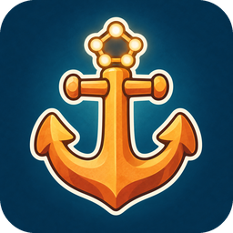

<p align="center">
  
</p>

<h1 align="center">Anchored OSS</h1>

<p align="center">
  Self-hosted team memory for AI coding agents.
</p>

<p align="center">
  <a href="https://github.com/jholhewres/anchored_oss/actions/workflows/ci.yml"></a>
  <a href="https://github.com/jholhewres/anchored_oss/releases/latest"></a>
  <a href="LICENSE"></a>
  
</p>

---

Anchored OSS is the team layer of the [Anchored](https://github.com/jholhewres/anchored) memory system: a server your organization runs on its own infrastructure so development teams share project knowledge — facts, decisions, learnings, plans, and knowledge-graph relationships — across Claude Code, Cursor, OpenCode, Gemini CLI, and any MCP-compatible tool.

The local [Anchored client](https://github.com/jholhewres/anchored) keeps personal memory, preferences, and embeddings on each developer's machine. Anchored OSS stores only organization-owned, project-level knowledge that is safe to share — enforced by configurable, privacy-first guardrails.

## Why

AI coding tools rely on scattered context files (`CLAUDE.md`, `AGENTS.md`, long prompts) that burn tokens, go stale, and lose detail during compaction. Anchored solves the personal-memory side locally; Anchored OSS solves the team side:

- **Shared, durable knowledge** — what one developer (or agent) learns, every developer's agent can recall.
- **Organization-owned** — your server, your database, your data. Single static binary, SQLite or PostgreSQL.
- **Privacy by default** — sync-time guardrails block secrets, local paths, personal scopes, and anything else your admins configure. Personal memory never leaves the developer's machine.

## Features

- **Organizations, teams, and projects** with role-based access and per-team project grants
- **Git-origin project routing** — two clones of the same repository, on any machines, converge on the same remote project
- **Knowledge graph** — entity/relationship triples synced alongside memories
- **Guardrail engine** — seeded secret/path/scope rules plus admin-defined keyword and RE2 rules, managed from the dashboard
- **Admin dashboard** embedded in the binary — overview, projects, members, API keys, guardrails, audit, health
- **Audit log** of every sync and administrative action
- **First-run onboarding wizard** — org, admin, and projects in one guided flow
- **Optional semantic search and RAG chat** when embeddings are configured

## Quick start

```bash
# Install the server (SQLite, PM2-managed, port 8771)
curl -fsSL https://raw.githubusercontent.com/jholhewres/anchored_oss/main/install/install.sh | sh
```

Open `http://your-server:8771`, complete the onboarding wizard, and copy the generated API key. Prefer containers? See [Docker Compose and other options](docs/deployment.md).

### Connect your team

Each developer installs the Anchored client and points it at the server:

```bash
curl -fsSL https://raw.githubusercontent.com/jholhewres/anchored/main/install/install.sh | bash
anchored remote configure --server http://your-server:8771 --key <api-key> --name your-org
anchored remote sync   # run inside a repo — routed by its git origin
```

From then on, saves auto-sync and every memory search transparently includes the team server's results.

## How it fits together

```text
Developer machine                      Your infrastructure
┌─────────────────────────┐            ┌─────────────────────────────┐
│ AI tool (MCP)           │            │ Anchored OSS                │
│   └── anchored client   │  ⇄ sync ⇄  │   ├── Organization          │
│        ├── personal     │  (guard-   │   │    ├── Teams + access   │
│        │   memory (local│   rails)   │   │    ├── Guardrails       │
│        │   only)        │            │   │    └── Audit log        │
│        └── project      │            │   └── Projects              │
│            memory       │            │        ├── Shared memories  │
└─────────────────────────┘            │        └── Knowledge graph  │
                                       └─────────────────────────────┘
```

See [ARCHITECTURE.md](ARCHITECTURE.md) for the full system map with diagrams.

## Documentation

| Document | Contents |
|---|---|
| [Deployment](docs/deployment.md) | Installer, Docker Compose, source builds, configuration, updating |
| [API Reference](docs/api.md) | Endpoints, auth scopes |
| [Architecture](ARCHITECTURE.md) | System overview, client↔server flow, feature map |
| [Development](docs/development.md) | Repository layout, build targets, conventions |
| [Sync Protocol](docs/sync-protocol.md) | Bidirectional sync specification |
| [Error Codes](docs/error-codes.md) | API errors and item-level rejection rules |

## Related projects

- [**anchored**](https://github.com/jholhewres/anchored) — the local-first memory client (CLI + MCP server) that pairs with this server

## Contributing

Contributions are welcome. Open an issue to discuss non-trivial changes, branch from `main`, keep `go test ./...`, `go vet ./...`, and `cd web && npm run build` green, and open a pull request describing the change and how you verified it. Conventions and build details live in [docs/development.md](docs/development.md).

## License

Anchored OSS is **source-available** under the **Functional Source License, Version 1.1, with an Apache 2.0 future grant** ([`FSL-1.1-ALv2`](LICENSE)).

In short: you may read, run, self-host (including inside a company), modify, and redistribute the Software for any purpose **except a Competing Use** — i.e. you may not offer it to others as a commercial product or service that substitutes for Anchored. Two years after each version is released, that version automatically converts to the **Apache License 2.0**.

See [LICENSE](LICENSE) for the full terms. Learn more about the FSL at <https://fsl.software>.
